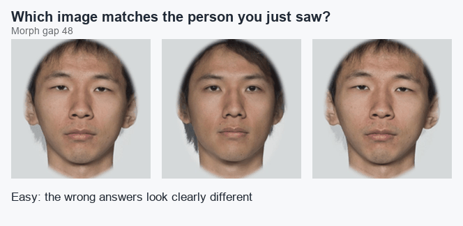

<div align="center">

# FaceIt

### Train the part of your brain that tells faces apart.

A free, private, offline-first web app for people with face blindness (prosopagnosia).
Short daily sessions. Adaptive difficulty. Nothing leaves your device.



<sub>The real training stimuli. The correct image never changes; the wrong answers creep closer every time you succeed.</sub>

</div>

---

## Imagine not knowing your own friends

You walk into a café. Someone waves. You have no idea who they are: not a stranger, a colleague you have worked beside for two years. Their eyes work. Their memory works. But the face gives you nothing, so you learn to cope: hair, voice, the way they walk, the jacket they always wear. When any of those change, the person vanishes.

That is **prosopagnosia**, or face blindness. It affects roughly **1 in 50 people**, which is about as common as red hair. Most of them have had it since birth and many do not realise it, because they assume everyone else is using the same tricks.

## A short history of a hidden condition

- **1800s** - Doctors describe patients who suddenly lose the ability to recognise familiar faces after a brain injury. The cases are treated as medical curiosities.
- **1947** - German neurologist Joachim Bodamer gives the condition its name, _prosopagnosia_, from the Greek for "face" and "lack of knowledge".
- **Late 20th century** - The condition is mostly associated with stroke and head injury. Artist Chuck Close and neurologist Oliver Sacks become its best-known public faces, both of them unable to recognise people they knew well.
- **Early 2000s** - Researchers realise that many people have _developmental_ prosopagnosia: a lifelong, often inherited difference, with no injury at all. Far more people are affected than anyone had thought.
- **2015** - The **PI20**, a 20-question self-report questionnaire (Shah et al.), gives people a validated way to find out whether their everyday experience matches face blindness.
- **Today** - Small laboratory studies report that structured training can help some people. There is still no widely available, research-informed app built for it.

That last gap is what FaceIt is for.

## Why training might help

The brain does not recognise a face by reading a feature list. It builds a holistic picture, and it learns to do that through enormous amounts of practice. In prosopagnosia, that learning seems to have stalled somewhere.

**Perceptual learning** is the brain's habit of getting better at telling similar things apart when it practises at the edge of its ability. Wine tasters, radiologists and chicken sexers all use it. Studies of face training in developmental prosopagnosia have used exactly this recipe:

1. Show faces that are _almost_ identical.
2. Keep the task hard enough that you sometimes get it wrong, but not so hard that you guess.
3. Repeat, daily, for weeks.

In published studies some participants improved on faces they were trained on, some on faces they had never seen, and in some cases the gains were still there months later. Others did not improve, and responses vary a lot from person to person. See the [research summary](docs/prosopagnosia-research.md) for the detail and sources.

> **Honest expectations.** FaceIt is a practice tool, not a treatment or a diagnosis. Training is not a cure, and how well it carries over to everyday life is still an open research question.

## What FaceIt does

|                         |                                                                                                                                                                                 |
| ----------------------- | ------------------------------------------------------------------------------------------------------------------------------------------------------------------------------- |
| **Find your baseline**  | Answer the PI20 questionnaire, then take a short perception test, to see where you start.                                                                                       |
| **Train at your edge**  | A staircase algorithm moves the difficulty after every answer so you spend your time at the point where learning happens (about 71% accuracy).                                  |
| **Learn from mistakes** | After a wrong answer you see your pick beside the right one, with the most different regions outlined, or flicker between the two to spot what changed.                         |
| **Match across photos** | At higher levels the right answer is a _different photograph_ of the same person (a smile instead of a neutral face), because real recognition never sees the same image twice. |
| **Learn real people**   | The `/learn` mode introduces four people by name, then asks you to name them from a different photo. The set rotates weekly so faces come back.                                 |
| **Watch it move**       | Threshold charts, streaks, accuracy and a baseline-corrected improvement score.                                                                                                 |
| **Keep your privacy**   | No account, no server, no analytics. Export or delete everything from Settings.                                                                                                 |

### How a trial works

1. **Look** (2 s): a target face appears.
2. **Mask** (0.5 s): a pattern wipes your visual memory so you cannot just compare pixels.
3. **Choose**: pick the match from three images.
4. **Learn**: if you were wrong, study exactly where the faces differ.
5. **Adapt**: two right in a row makes the next one harder; one wrong makes it easier.

### The difficulty ladder

Difficulty is not a vague slider. It is the **morph distance** between the right answer and the wrong ones, and every stimulus is a real photograph blend:

| Staircase level | Morph gap | What you get                                           |
| --------------- | --------- | ------------------------------------------------------ |
| 73-88           | 48        | Wrong answers are obviously different                  |
| 58-72           | 36        | Differences are clear but need attention               |
| 43-57           | 24        | A different photo of the person, with small variations |
| 28-42           | 12        | A different photo, nearly identical wrong answers      |

The stimuli are cropped to the inner face, with no hair or clothing, because blended hair leaves a ghost image that would otherwise give the answer away.

> The gap sizes and the level where different-photo trials begin are educated guesses that have not yet been checked against real users, ideally people with face-recognition difficulty. Each trial now records its exact level, gap and photo type so they can be tuned from real data.

## Try it

```bash
git clone https://github.com/ChrisBrooksbank/faceit.git
cd faceit
npm install
npm run dev
```

Then open the URL it prints. Build a production, installable PWA with `npm run build && npm run preview`. Requires Node.js 20+.

## Privacy by design

- **No cloud.** Everything is stored in your browser's IndexedDB.
- **No accounts.** FaceIt never asks who you are.
- **No tracking.** No analytics, no third-party scripts.
- **Works offline.** After the first load, it is a self-contained PWA.
- **Your data is yours.** Export it as JSON or delete it from Settings.

## Under the hood

Built with **SvelteKit** and **Svelte 5** (runes), **TypeScript** in strict mode, **Zod** for validation and **IndexedDB** via `idb` for storage. It ships as a PWA through `@vite-pwa/sveltekit`.

Quality is enforced rather than hoped for: ESLint with complexity limits, Prettier, Knip for dead code, **Vitest** with an 80% coverage gate, **Playwright** end-to-end tests across desktop and mobile browsers, and a pre-commit hook that runs type checks and lint-staged. A WCAG 2.1 AA [accessibility audit](docs/accessibility-audit.md) is included.

The face stimuli are generated by a reproducible Python pipeline (`scripts/generate-face-morphs.py`) using MediaPipe landmarks, so difficulty, cropping and difference highlighting all come from the same geometry.

<details>
<summary><strong>All npm scripts</strong></summary>

| Command                 | Description               |
| ----------------------- | ------------------------- |
| `npm run dev`           | Start development server  |
| `npm run build`         | Production build          |
| `npm run preview`       | Preview production build  |
| `npm test`              | Run tests in watch mode   |
| `npm run test:run`      | Run tests once            |
| `npm run test:coverage` | Generate coverage report  |
| `npm run test:e2e`      | Run Playwright E2E tests  |
| `npm run lint`          | ESLint and svelte-check   |
| `npm run format`        | Format code with Prettier |
| `npm run typecheck`     | TypeScript type checking  |
| `npm run knip`          | Find unused code          |
| `npm run check`         | Run every check           |

</details>

## Roadmap

- [x] PI20 assessment, baseline test, adaptive training, progress and settings
- [x] Real face morphs, different-photo trials, 40 face pairs
- [x] Identity learning mode
- [ ] Tune the difficulty ladder against real users
- [ ] Viewpoint changes (3/4 views) and more expressions
- [ ] Save identity-learning results and add spaced repetition
- [ ] A clinical review of the wording and the training protocol

## Documentation

- [MVP specification](docs/mvp-specification.md)
- [Research summary](docs/prosopagnosia-research.md)
- [User research](docs/interview-report.md)
- [Accessibility audit](docs/accessibility-audit.md)

## Contributing

Ideas, bug reports and especially feedback from people with face-recognition difficulty are very welcome. Open an issue or a pull request. Please run `npm run check` before you submit.

## Licence and credits

Code is released under the [MIT licence](LICENSE).

Face stimuli are generated from the **Face Research Lab London Set** by Lisa DeBruine and Benedict Jones ([DOI 10.6084/m9.figshare.5047666.v5](https://doi.org/10.6084/m9.figshare.5047666.v5)), licensed [CC BY 4.0](https://creativecommons.org/licenses/by/4.0/). See [the attribution file](static/faces/ATTRIBUTION.md). Thanks also to the research participants who shared their experiences and to the prosopagnosia research community.

---

<sub>FaceIt is not a medical device and does not diagnose or treat prosopagnosia. It is a practice tool informed by published research. Consult a healthcare professional for medical advice.</sub>
